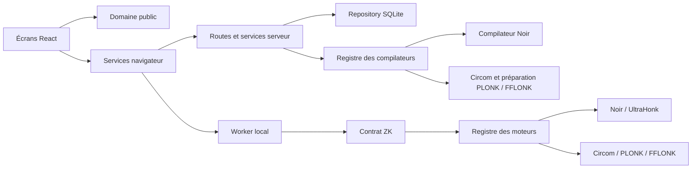

# Architecture

Le refactoring conserve les écrans, les classes CSS, les routes HTTP, les tables SQLite et le format clair-proof/1 du MVP.

## Responsabilités

| Couche              | Emplacement                                | Responsabilité                                                                     |
| ------------------- | ------------------------------------------ | ---------------------------------------------------------------------------------- |
| Interface           | src/features/                              | Un module par écran ou fonctionnalité ; aucune dépendance aux SDK cryptographiques |
| Composants partagés | src/components/                            | Présentation réutilisable                                                          |
| Services navigateur | src/lib/                                   | HTTP, téléchargement, formatage et cycle de vie du worker                          |
| Domaine             | shared/                                    | Arbre typé, validation, empreintes, paramètres publics et enveloppe de preuve      |
| Application ZK      | zk/operations.mjs, zk/registry.mjs         | Contrat commun et sélection explicite d’un moteur approuvé                         |
| Adaptateur Noir     | zk/noir/                                   | Traduction Noir, compilation, WASM et preuve UltraHonk                             |
| Composition HTTP    | server/app.mjs                             | Assemblage des dépendances et ordre des middlewares                                |
| Routes              | server/routes/                             | Authentification, facturation, circuits/preuves et émetteurs                       |
| Services serveur    | server/billing.mjs, server/compiler.mjs    | Cycle Stripe et compilation bornée/cachée                                          |
| Persistance         | server/database.mjs, server/repository.mjs | Schéma, migration idempotente et requêtes SQL paramétrées                          |

Les données privées passent du formulaire au worker uniquement. La compilation reçoit le circuit public ; l’enregistrement reçoit l’enveloppe publique, jamais le témoin.

## Moteurs disponibles

Le catalogue `shared/engines.mjs` expose Noir / UltraHonk, Circom / PLONK et Circom / FFLONK. Le champ optionnel `circuit.engine` conserve le choix sans modifier les anciens circuits. Les adaptateurs Circom résident dans `zk/circom/`. Voir [ENGINES.md](ENGINES.md) pour les paramètres, limites et compatibilité.

## Ajouter un moteur ZK

1. Créer un dossier zk/nom-du-moteur avec un identifiant versionné et stable, puis l’ajouter au catalogue shared/engines.mjs.
2. Fournir un adaptateur serveur avec id et compile(circuit), retournant hash et artifact, éventuellement source. L’empreinte correspond exactement au domaine canonique.
3. Fournir un adaptateur navigateur avec id, prove({circuit, compiled, values, onProgress}) et verify({envelope, compiled, onProgress}). Le premier retourne une enveloppe publique, le second {valid: boolean}.
4. Enregistrer statiquement le compilateur dans createCompiler (server/compiler.mjs) et l’adaptateur navigateur dans src/zk.worker.js. Aucun chemin de module n’est lu depuis un fichier de preuve.
5. Sélectionner le même identifiant dans compileForEngine et launchProof. Les vérifications sélectionnent automatiquement le moteur indiqué par l’enveloppe, parmi ceux explicitement enregistrés.
6. Ajouter des tests dédiés pour le contrat, de vraies preuves, les falsifications et la libération des ressources, puis le parcours navigateur.

Le registre vérifie les méthodes requises, refuse les doublons et les moteurs inconnus. Le compilateur contrôle l’empreinte renvoyée par l’adaptateur. Le worker contrôle l’empreinte et l’identifiant du moteur avant de l’appeler.

### Contrat de l’enveloppe v1

Le format v1 utilise une preuve binaire encodée en base64 et un tableau de paramètres publics hexadécimaux. Le premier paramètre lie les 248 premiers bits de SHA-256 au circuit ; les suivants suivent l’ordre des entrées publiques. Le moteur doit contraindre ces valeurs et disposer d’un encodage capable de représenter ce contexte. Un moteur ayant une autre sémantique nécessite un adaptateur explicite ou une nouvelle version d’enveloppe, pas une interprétation approximative de v1.

Les adaptateurs reconstruisent leurs clés depuis le circuit compilé. Une clé de vérification fournie librement par le détenteur d’une preuve n’est jamais utilisée.

## Compatibilité et migration

- Le schéma public des circuits et son empreinte canonique sont conservés.
- Le moteur historique noir-beta9-ultrahonk-0.87 reste enregistré avec keccakZK activé.
- Les anciens fichiers .clair.json et les archives SQLite sont lisibles.
- Le démarrage ajoute seulement les tables/index manquants ; il ne réinitialise pas les comptes.
- Les anciens mots de passe restent vérifiables et sont re-hachés après une connexion réussie.
- L’application serveur peut être importée sans ouvrir un port ; startServer est testable et propose un arrêt explicite.

L’architecture reste volontairement celle d’un MVP à un processus : le registre, les limites de débit, la file de compilation et les verrous Stripe sont locaux au processus.
