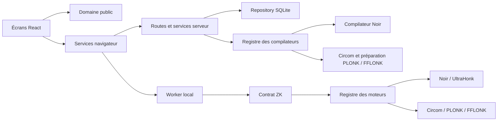

# Architecture

Le MVP conserve ses écrans, classes CSS, routes HTTP et tables SQLite. Les enveloppes historiques clair-proof/1 restent compatibles ; clair-proof/2 ajoute un résultat public vrai ou faux et des valeurs publiques lisibles.

## Responsabilités

| Couche              | Emplacement                                | Responsabilité                                                                     |
| ------------------- | ------------------------------------------ | ---------------------------------------------------------------------------------- |
| Interface           | src/features/                              | Un module par écran ou fonctionnalité ; aucune dépendance aux SDK cryptographiques |
| Composants partagés | src/components/                            | Présentation réutilisable                                                          |
| Services navigateur | src/lib/                                   | HTTP, téléchargement, formatage et cycle de vie du worker                          |
| Domaine             | shared/                                    | Arbre typé, validation, empreintes, paramètres publics et enveloppe de preuve      |
| Application ZK      | zk/operations.mjs, zk/registry.mjs         | Contrat commun et sélection explicite d’un moteur approuvé                         |
| Adaptateur Noir     | zk/noir/                                   | Traduction Noir, compilation, WASM et preuve UltraHonk                             |
| Composition HTTP    | server/app.mjs                             | Assemblage des dépendances et ordre des middlewares                                |
| Routes              | server/routes/                             | Authentification, facturation, circuits/preuves et émetteurs                       |
| Services serveur    | server/billing.mjs, server/compiler.mjs    | Cycle Stripe et compilation bornée/cachée                                          |
| Persistance         | server/database.mjs, server/repository.mjs | Schéma, migration idempotente et requêtes SQL paramétrées                          |

Les données privées passent du formulaire au worker uniquement. La compilation reçoit le circuit public ; l’enregistrement reçoit l’enveloppe publique, jamais le témoin.

## Moteurs disponibles

Le catalogue `shared/engines.mjs` expose Noir / UltraHonk, Circom / PLONK et Circom / FFLONK. Le champ optionnel `circuit.engine` conserve le choix sans modifier les anciens circuits. Les adaptateurs Circom résident dans `zk/circom/`. Voir [ENGINES.md](ENGINES.md) pour les paramètres, limites et compatibilité.

## Ajouter un moteur ZK

1. Créer un dossier zk/nom-du-moteur avec un identifiant versionné et stable, puis l’ajouter au catalogue shared/engines.mjs.
2. Fournir un adaptateur serveur avec id et compile(circuit), retournant hash et artifact, éventuellement source. L’empreinte correspond exactement au domaine canonique.
3. Fournir un adaptateur navigateur avec id, prove({circuit, compiled, values, onProgress}) et verify({envelope, compiled, onProgress}). Le premier retourne une enveloppe publique, le second {valid: boolean}.
4. Enregistrer statiquement le compilateur dans createCompiler (server/compiler.mjs) et l’adaptateur navigateur dans src/zk.worker.js. Aucun chemin de module n’est lu depuis un fichier de preuve.
5. Sélectionner le même identifiant dans compileForEngine et launchProof. Les vérifications sélectionnent automatiquement le moteur indiqué par l’enveloppe, parmi ceux explicitement enregistrés.
6. Ajouter des tests dédiés pour le contrat, de vraies preuves, les falsifications et la libération des ressources, puis le parcours navigateur.

Le registre vérifie les méthodes requises, refuse les doublons et les moteurs inconnus. Le compilateur contrôle l’empreinte renvoyée par l’adaptateur. Le worker contrôle l’empreinte et l’identifiant du moteur avant de l’appeler.

### Contrat de l’enveloppe v1

Le format v1 utilise une preuve binaire encodée en base64 et un tableau de paramètres publics hexadécimaux. Le premier paramètre lie les 248 premiers bits de SHA-256 au circuit ; les suivants suivent l’ordre des entrées publiques. Le moteur doit contraindre ces valeurs et disposer d’un encodage capable de représenter ce contexte. Un moteur ayant une autre sémantique nécessite un adaptateur explicite ou une nouvelle version d’enveloppe, pas une interprétation approximative de v1.

Les adaptateurs reconstruisent leurs clés depuis le circuit compilé. Une clé de vérification fournie librement par le détenteur d’une preuve n’est jamais utilisée.

### Contrat de l’enveloppe v2

Un circuit de version 2 contraint le résultat de la règle à un booléen public placé immédiatement après le contexte. L’enveloppe clair-proof/2 ajoute result et publicData, dont la concordance avec les paramètres encodés est contrôlée par parseProof. buildProofEnvelope construit ces champs à partir des paramètres réellement produits par le moteur. Les consommateurs doivent distinguer la validité cryptographique du résultat de la règle.

shared/evaluate.mjs évalue localement les données avant le calcul pour signaler champs manquants, divisions par zéro et dépassements. Ce diagnostic ne remplace jamais les contraintes des moteurs. shared/validation.mjs traduit les erreurs de schéma en messages indiquant les champs concernés, sans reprendre les valeurs rejetées.

### Provenance des entrées signées

shared/attestations.mjs fournit le format versionné, les signatures Web Crypto, les empreintes et les contrôles de provenance. Une entrée signed référence une politique de source liée à l’empreinte du circuit. L’enveloppe clair-proof/3 joint les attestations publiques attendues. clair-proof/4 ajoute les signatures privées Noir : seules les dates sont exposées dans privateAttestations, les attestations privées sont retirées de l’export. shared/private-attestations.mjs définit le message binaire signé et la liaison des dates ; zk/noir/private-signatures.mjs génère les contraintes SHA-256/P-256 et prépare le témoin privé. Les moteurs qui ne déclarent pas cette capacité sont refusés. zk/operations.mjs ajoute à la vérification ZK les contrôles de signature, de valeur publique et d’approbation courante. Les écrans ne traitent jamais une clé embarquée comme une autorité. Voir [SOURCES.md](SOURCES.md).

## Compatibilité et migration

- Le schéma public des circuits et son empreinte canonique sont conservés.
- Le moteur historique noir-beta9-ultrahonk-0.87 reste enregistré avec keccakZK activé.
- Les exports et sélecteurs de fichiers utilisent `.clair` ; les protocoles JSON et les archives SQLite restent inchangés.
- Le démarrage ajoute seulement les tables/index manquants ; il ne réinitialise pas les comptes.
- Les anciens mots de passe restent vérifiables et sont re-hachés après une connexion réussie.
- L’application serveur peut être importée sans ouvrir un port ; startServer est testable et propose un arrêt explicite.

L’architecture reste volontairement celle d’un MVP à un processus : le registre, les limites de débit, la file de compilation et les verrous Stripe sont locaux au processus.

## Vérificateur portable

`offline/` fournit une interface indépendante et un serveur limité à la boucle locale. La compilation et la vérification réutilisent les adaptateurs ZK du projet dans un processus isolé. `scripts/build-offline.mjs` assemble les modules explicitement autorisés, leurs dépendances, Node et les paramètres publics. `server/routes/offline.mjs` distribue cette archive avec un instantané `clair-trust/1` du registre, validé par `shared/trust-snapshot.mjs`. Aucun secret du serveur n’entre dans le paquet. Les détails d’utilisation, de confiance et de préparation sont dans [OFFLINE.md](OFFLINE.md).

Les offres sont centralisées dans server/plans.mjs. La migration SQLite v2 ajoute le plan et les réservations de génération sans supprimer les données existantes. Le repository applique les quotas de stockage et de génération dans des transactions. Les routes administrateur ne renvoient que des statistiques agrégées aux identifiants autorisés. Voir [BILLING.md](BILLING.md) pour les règles de comptage et Stripe.

## Circuits prêts à utiliser

La page Mes circuits présente un catalogue : majorité, revenu strictement supérieur à un seuil, revenus couvrant trois fois un loyer et département francilien. La sélection enregistre un circuit public version 2 puis ouvre directement le formulaire de génération. Un circuit identique déjà présent est réutilisé, sans consommer de place supplémentaire. Les données privées ne sont jamais préremplies ni envoyées lors de cet enregistrement.

Les modèles et leurs paramètres publics initiaux sont définis dans src/features/circuits/catalog-model.js. Le moteur par défaut est Noir ; les options avancées du catalogue permettent de choisir un autre moteur. Le bouton Circuit personnalisé ouvre l’éditeur existant. Depuis un modèle, Personnaliser ce circuit permet notamment de configurer des attestations : les modèles de départ utilisent des valeurs déclarées.

Les seuils de revenus et les loyers sont exprimés en euros entiers par mois. Le seuil de majorité est une date publique, initialisée à la date d’il y a 18 ans, et ajustable dans le formulaire. Les seuils effectivement utilisés sont inclus dans la preuve ; le vérificateur doit les examiner.
